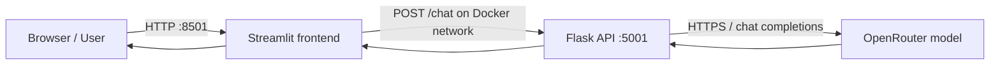

# DT1 2026 — AI Assistant

## Author and accounts
- Student: Abdoul Ahly NOUHOUM SATAROU
- GitHub username: ahlyari
- Docker Hub username: abdoulnouhouhoum

## Overview
Streamlit browser UI sends a POST JSON request to Flask (`/chat`). Flask sends a chat completion request to OpenRouter using a secret API key from its environment. OpenRouter returns text to Flask; Flask returns JSON `{ "ack": "..." }` to Streamlit.

## Live Application

The AI Assistant is deployed on Google Cloud and is accessible at:

**Application URL:**  Open: http://localhost:8501, ask a question, click Send.

- Platform: Google Cloud Compute Engine
- VM: dt1-2026-ubuntu
- Frontend: Streamlit
- Backend: Flask
- Public port: 8501
  

## Architecture

## API design
- `GET /ping` returns `{"ack":"pong"}`.
- `POST /chat` accepts JSON `{"input":"What is cloud computing?", "model_id":"nvidia/nemotron-3-ultra-550b-a55b:free"}` and returns `{"ack":"model response"}`.
- HTTP 400: malformed or missing prompt; 500: API key missing; 502: upstream OpenRouter failure.
- The secret API key is never sent from frontend to backend in a URL. Flask obtains it as an environment variable.

## Local execution on Windows
In project directory, create `.env` from `.env_example` and insert your own API key. Never commit `.env`.
- Terminal 1: `py -3.13 -m pipenv run python api.py`
- Terminal 2: `py -3.13 -m pipenv run python -m streamlit run frontend.py`
- Open : http://34.55.141.134:8501, ask a question, click Send.

## Docker Compose
- `docker compose config --quiet`
- `docker compose up --build -d`
- `docker compose ps`
- Open http://localhost:8501
- `docker compose logs --tail 100 api`
- `docker compose down`

## Docker Hub
After creating a private repository for dt1-api and a public repository for dt1-frontend:
- Set `DOCKERHUB_USERNAME` in `.env`, then `docker compose build`
- `docker login`
- `docker compose push`
- For GCP, the VM must authenticate to Docker Hub to pull the private API image.

## Google Cloud deployment
Create an Ubuntu VM in Compute Engine. Check billing eligibility and VM costs. Install Docker Engine and Compose plugin from official Docker instructions. Copy only the deployment configuration and `.env` securely onto the VM. Docker login on the VM for the private API image, then `docker compose pull` and `docker compose up -d --no-build`.

For instructor evaluation, TCP port 8501 is temporarily accessible from the Internet through the Google Cloud firewall rule `allow-dt1-streamlit-8501`. The Flask backend on port 5001 is not publicly exposed.

Live application: http://34.55.141.134:8501

Public access will be restricted again after the evaluation.

Use ingress firewall restrictions to permit TCP/8501 only from your trusted public IP/CIDR and the instructor-provided CIDR. Do not publicly open TCP/5001; it is Docker-internal only. Confirm instructor access and document the rule.

## Testing and limitations
- `curl http://127.0.0.1:5001/ping` when running locally.
- Ask an AI question in Streamlit and verify visible response.
- Free OpenRouter models may be unavailable, rate-limited or subject to account restrictions; inspect errors.
- Deployment does not include authentication inside Streamlit, a database, observability, or high availability. Firewall IP-based restrictions are the primary access control.

## Evidence of deliverable
- REPLACE: GCP VM name/region (never publish credentials)
- REPLACE: screenshot / output of `docker compose ps`
- REPLACE: screenshot of Streamlit responding
- REPLACE: firewall rules and allowed CIDRs (no secrets)
- REPLACE: GitHub repo link and Docker Hub repo names
- REPLACE: professor collaborator sid027 invited and accepted/pending
